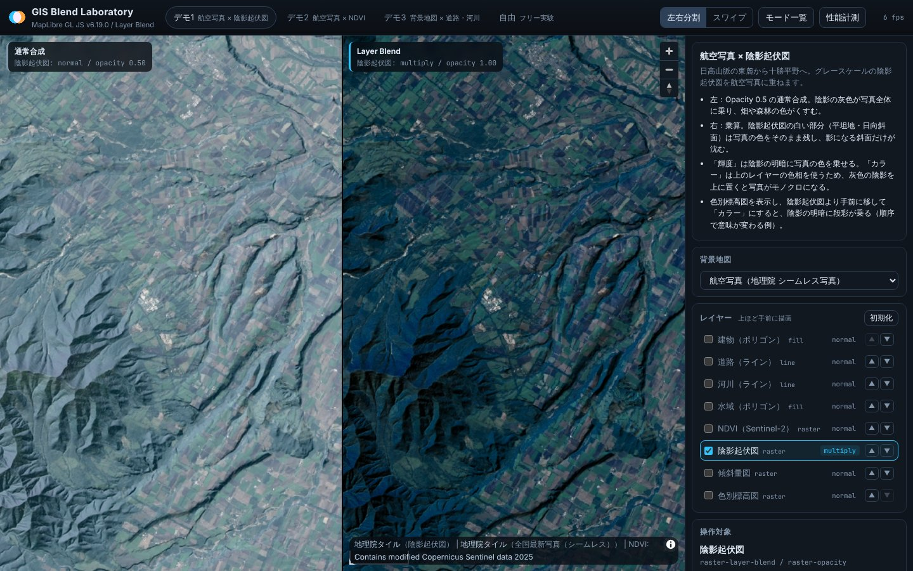

# GIS Blend Laboratory（maplibre-layer-blend）

MapLibre GL JS v6.18 で追加された Layer Blend（`raster-layer-blend` / `fill-layer-blend` / `line-layer-blend`）を、十勝地方の GIS データで検証する Web アプリです。
同じ地点を「通常合成（Opacity）」と「Layer Blend」の 2 画面で同期表示し、ブレンドモード・不透明度・描画順序を変えながら見た目と画素値を比較できます。



## 機能

| 区分 | 内容 |
|---|---|
| 地図 | 初期表示は十勝地方。ズーム・移動・回転・ピッチ操作、背景地図の切り替え（地理院 航空写真／淡色／標準／ダーク／単色） |
| レイヤー | ラスター 4 種（陰影起伏図・傾斜量図・色別標高図・NDVI）、ベクター 4 種（水域・河川・道路・建物）。表示切替・描画順序の変更 |
| ブレンド操作 | 対象レイヤーの選択、7 モードの切り替え（日本語の説明・式・GPU 処理経路を表示）、左右別の Opacity、設定の初期化 |
| 比較表示 | 左右 2 画面の同期表示、スワイプ比較（スマートフォンでは上下分割／スワイプ） |
| ピクセル検査 | 地図をクリックすると「下地」「対象レイヤー単体」「合成結果」の RGB を読み、W3C の式で計算した理論値と並べる |
| NDVI 読み取り | カーソル位置の NDVI の元の値と、凡例上の色を表示（ブレンド後の色と区別するため） |
| 性能計測 | 対象レイヤーを 1/4/8 枚に複製し、モードごとの 1 フレーム描画時間を計測。Markdown でコピー可 |
| コード表示 | 右画面の設定を `map.setPaintProperty(...)` の形で表示 |

### デモシナリオ

| | 内容 | 既定の設定（右画面） |
|---|---|---|
| デモ1 | 航空写真 × 陰影起伏図（日高山脈東麓〜十勝平野） | 陰影起伏図 `raster-layer-blend: multiply`、左は Opacity 0.5 |
| デモ2 | 航空写真 × NDVI（帯広市周辺、Sentinel-2 2025-06-24） | NDVI `raster-layer-blend: color`、左は Opacity 0.6 |
| デモ3 | 背景地図 × 道路・河川（帯広市街・十勝川） | 道路・河川 `line-layer-blend: screen`、水域は normal |
| 自由 | 全レイヤーを自由に組み合わせ | — |

## 使い方

```bash
npm install
```

```bash
npm run dev
```

```bash
npm run build
```

検証（スクリーンショット・ピクセル照合・順序・性能）を再実行する場合は、ビルド後にプレビューサーバーを起動してからスクリプトを実行します。結果は `docs/screenshots/` と `docs/results/` に出力されます。

```bash
npx vite preview --port 4173
```

```bash
node scripts/verify.mjs http://localhost:4173/
```

## Layer Blend の仕様（調査結果）

調査対象：maplibre-gl 6.19.0 の CHANGELOG とソースコード、@maplibre/maplibre-gl-style-spec 26.9.0 の `v8.json`、公式サンプル「Interactive layer blending」。

- v6.18.0 で `raster-layer-blend`（[#8986](https://github.com/maplibre/maplibre-gl-js/pull/8986)）と `{line,fill}-layer-blend`（[#8073](https://github.com/maplibre/maplibre-gl-js/pull/8073)）が追加された
- 対象は **raster / fill / line レイヤーのみ**。hillshade、color-relief、background、circle、symbol、heatmap、fill-extrusion には同等のプロパティがない
- 値は `normal`（既定）・`multiply`・`screen`・`overlay`・`plus-lighter`・`color`・`luminosity` の 7 種
- `property-type: constant`、`transition: false`。式（ズーム補間・データ駆動）やトランジションは使えない
- 合成はフィーチャー単位ではなくレイヤー全体で行われる（レイヤーを一度オフスクリーンに描いてから合成する）
- MapLibre Native（Android/iOS）は `sdk-support` 上で未対応（issue へのリンクのみ）

### ブレンドモード比較表

Cs＝上のレイヤー、Cb＝下地（0〜1）。分離型は RGB 各チャンネルに適用。

| 値 | 名称 | 式 | 効果 | GIS での使いどころ | GPU 処理（maplibre-gl 6.19.0） |
|---|---|---|---|---|---|
| `normal` | 通常 | Cs | 通常のアルファ合成 | 比較の基準 | 通常のアルファブレンド |
| `multiply` | 乗算 | Cs × Cb | 必ず暗くなる。白は変化なし | 陰影起伏図・傾斜量図を写真や段彩に重ねる | シェーダ合成（背景コピー） |
| `screen` | スクリーン | Cs + Cb − Cs×Cb | 必ず明るくなる。黒は変化なし | 暗い背景で線を光らせる | 固定機能ブレンド `(ONE, ONE_MINUS_SRC_COLOR)` |
| `overlay` | オーバーレイ | Cb≤0.5: 2CsCb／それ以外: 1−2(1−Cs)(1−Cb) | 下地の明暗を保ってコントラストを上げる | 主題図を質感を残して載せる | シェーダ合成（背景コピー） |
| `plus-lighter` | 加算 | min(1, Cs + Cb) | 加算。1 で飽和 | 発光・密度の積み上げ | 固定機能ブレンド `(ONE, ONE)` |
| `color` | カラー | SetLum(Cs, Lum(Cb)) | 上の色相・彩度＋下の輝度 | 陰影の上に段彩を乗せる | シェーダ合成（背景コピー） |
| `luminosity` | 輝度 | SetLum(Cb, Lum(Cs)) | 上の輝度＋下の色相・彩度 | 陰影の明暗を下地の色に移す | シェーダ合成（背景コピー） |

モード別の見た目は [docs/screenshots/modes/](docs/screenshots/modes/) にあります（`demo1-*.jpg` など。`*-opacity.jpg` は左画面の通常合成）。

## 検証結果の要約

詳細は [docs/results/README.md](docs/results/README.md)。

- **ピクセル照合**：ラスター（陰影起伏図・NDVI）、ポリゴン（水域）、ライン（道路）の 4 データ × 7 モード × 不透明度 1 / 0.5 で、実測値と W3C 式の理論値の差は RGB 最大 1（8bit の丸め誤差の範囲）
- **不透明度の効き方**：不透明度は上のレイヤーの色（premultiplied）に掛かってから合成される。乗算・不透明度 0.5 は「元の写真」と「乗算結果」の中間になる
- **描画順序**：乗算同士・スクリーン同士は順序を入れ替えても差 1 以下。乗算とスクリーン、オーバーレイ、カラーと輝度の組み合わせでは順序で結果が変わる（最大差 44〜154）
- **性能**：[docs/results/README.md](docs/results/README.md) を参照。SwiftShader（CPU によるソフトウェア描画）での参考値で、実機 GPU の性能ではない

## 技術的な制限事項

- WebGL2 前提（合成シェーダが `texelFetch` を使う。MapLibre GL JS v6 自体も WebGL2 が必須）
- 対象外のレイヤー種別がある。陰影には `hillshade` レイヤーではなく、陰影起伏図の**ラスタータイル**を使う必要がある
- 複数レイヤーをグループ化して 1 つのブレンドとして合成することはできない。ブレンドの相手は「そのレイヤーより下に描かれたものすべて」（背景色を含む）
- `multiply` / `overlay` / `color` / `luminosity` は描画のたびに背景をテクスチャにコピーする。ラスターは画面全体、fill/line はタイル範囲の外接矩形、地形（terrain）や地球儀表示ではやはり画面全体がコピー対象になる
- シェーダ合成のレイヤーがあると、それより下のレイヤーは不透明パスの最適化（手前から描いて深度で省略）から外れる
- fill/line は `*-layer-opacity` が 1 未満でもオフスクリーン合成になる。normal でも不透明度を下げるだけで描画コストが増える
- Overdraw Inspector 有効時はシェーダ合成が無効になる
- Mesa 24.3〜25.3.1 の Intel Gen12 で連続する合成レイヤーに不具合があり、6.18.0 で回避策（`gl.flush()`）が入っている
- ブレンド後の色は凡例と一致しない。NDVI などの数値ラスターでは、色から値を読み取れなくなる

## 使用データと出典・ライセンス

| データ | 提供元 | 利用条件 | 本アプリでの扱い |
|---|---|---|---|
| 全国最新写真（シームレス）、淡色地図、標準地図、陰影起伏図、傾斜量図、色別標高図 | 国土地理院 [地理院タイル](https://maps.gsi.go.jp/development/ichiran.html) | [国土地理院コンテンツ利用規約](https://www.gsi.go.jp/kikakuchousei/kikakuchousei40182.html)（出典明示で利用可） | タイルをそのまま表示。「ダーク」は淡色地図を MapLibre の raster-brightness で明度反転したもの |
| 道路・河川・水域・建物 | [OpenFreeMap](https://openfreemap.org/)（[OpenMapTiles](https://openmaptiles.org/) スキーマ） | © OpenStreetMap contributors、[ODbL](https://www.openstreetmap.org/copyright) | ベクタータイルを表示 |
| NDVI（`public/data/ndvi_obihiro_20250624.tif`） | Copernicus Sentinel-2 L2A（S2A_54TXN_20250624_0_L2A、[Earth Search](https://earth-search.aws.element84.com/v1) 経由） | [Copernicus データの利用条件](https://sentinels.copernicus.eu/documents/247904/690755/Sentinel_Data_Legal_Notice)（無償・出典明示）。表記「Contains modified Copernicus Sentinel data 2025」 | B04・B08 から NDVI=(B08−B04)/(B08+B04) を算出し、範囲 143.00–143.32E / 42.84–43.02N を約 20m（1300×1000 画素、EPSG:4326）に再サンプリング。値×10000 の Int16、欠測 −32768 の Cloud Optimized GeoTIFF。着色はブラウザで geotiff.js により実施 |

疑似データは使用していません。NDVI は実データですが、上記の加工（再サンプリング・量子化）を行っています。

## デプロイ（GitHub Pages）

`main` への push で `.github/workflows/deploy.yml` が動き、`npm run build` の成果物（`dist/`）を GitHub Pages に公開します。
ビルドは相対パス（`vite.config.ts` の `base: './'`）なので、`https://<user>.github.io/maplibre-layer-blend/` のようなサブパスでもそのまま動きます。

初回のみ、リポジトリの Settings → Pages → Build and deployment の Source を「GitHub Actions」にしてください。
private リポジトリで Pages を使うには GitHub Pro / Team 以上のプランが必要で、公開されたサイト自体は誰でも閲覧できます。

## ファイル構成

```
src/
  main.ts         画面・イベント
  compare.ts      2 画面の生成・視点同期・分割/スワイプ
  layers.ts       ソース・レイヤー定義、スタイル生成
  blendModes.ts   モード一覧（日本語説明）と W3C 式の参照実装
  pixel.ts        ピクセル検査
  bench.ts        性能計測
  ndvi.ts         GeoTIFF 読み込みとカラーマップ
  state.ts        デモシナリオと状態
scripts/verify.mjs  Playwright による検証
.github/workflows/deploy.yml  GitHub Pages へのデプロイ
docs/article.md     Advent Calendar 記事の下書き
```

## ライセンス

コードは MIT License。地図データ・衛星データの権利は上記の各提供元に帰属します。
