# MapLibre GL JS v6.18の新機能「Layer Blend」で地図を合成してみた

この記事は MapLibre Advent Calendar 2026 の ○日目の記事です。

MapLibre GL JS v6.18.0 で、レイヤーの合成方法を指定する `raster-layer-blend` / `fill-layer-blend` / `line-layer-blend` が追加されました。
陰影起伏図を航空写真に「乗算」で重ねる、暗い背景の上で道路を「スクリーン」で光らせる、といった GIS ソフトや画像編集ソフトでおなじみの表現が、スタイルの paint プロパティ 1 行で書けるようになります。

公式サンプルはポリゴン 1 枚のデモなので、今回は十勝地方の航空写真・陰影起伏図・NDVI・道路データを使って、従来の Opacity による重ね合わせと何が違うのかを、見た目と画素値の両方で確かめました。

- デモ：https://shinyanakashima.github.io/maplibre-layer-blend/
- リポジトリ：https://github.com/shinyanakashima/maplibre-layer-blend

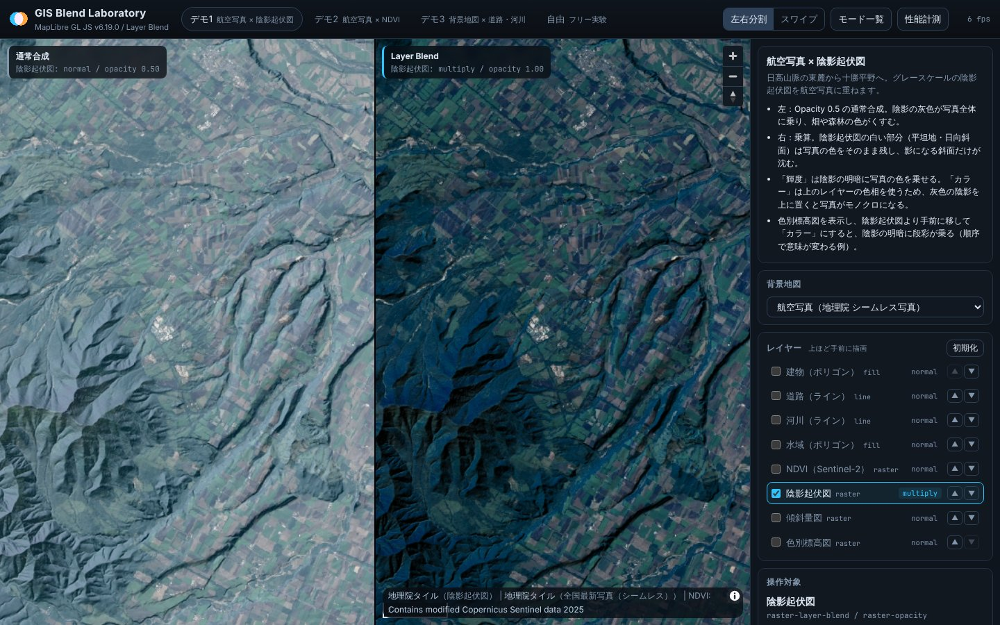

検証環境は maplibre-gl 6.19.0（6.18.0 の機能を含む最新版）です。

## 1. MapLibre GL JS v6.18で何が変わったのか

CHANGELOG の 6.18.0 から、Layer Blend に関係する項目は次の 3 つです。

- Add `raster-layer-blend` support（[#8986](https://github.com/maplibre/maplibre-gl-js/pull/8986)）
- Add `{line,fill}-layer-blend` support（[#8073](https://github.com/maplibre/maplibre-gl-js/pull/8073)）
- Fix glitches between consecutive `-layer-opacity` or `-layer-blend` layers on Intel Gen12 with Mesa 24.3 to 25.3.1（[#9006](https://github.com/maplibre/maplibre-gl-js/pull/9006)）

前提として、v6.0.0 で `fill-layer-opacity` / `line-layer-opacity` が入っています。これは「フィーチャーごと」ではなく「レイヤー全体」に効く不透明度で、重なったポリゴンや線が濃くならず、1 枚の面として透けます。Layer Blend はこの「レイヤー全体を一度描いてから合成する」仕組みの上に、合成の計算式を選べるようにしたもの、と理解すると全体像がつかみやすいです。

## 2. Layer Blendとは

使い方は paint プロパティを 1 つ指定するだけです。

```js
map.addLayer({
  id: 'hillshade',
  type: 'raster',
  source: 'gsi-hillshade',
  paint: {
    'raster-layer-blend': 'multiply'
  }
});

// 後から変更する場合
map.setPaintProperty('hillshade', 'raster-layer-blend', 'screen');
```

Style Specification（@maplibre/maplibre-gl-style-spec 26.9.0 の `v8.json`）で確認できる仕様は次のとおりです。

| 項目 | 内容 |
|---|---|
| 対象レイヤー | `raster`、`fill`、`line` の 3 種類のみ |
| 値 | `normal`（既定）、`multiply`、`screen`、`overlay`、`plus-lighter`、`color`、`luminosity` |
| property-type | `constant`（式・ズーム補間・データ駆動スタイルは不可） |
| transition | `false` |
| Native（Android/iOS） | `sdk-support` は issue へのリンクのみで、未対応 |

`hillshade`、`color-relief`、`background`、`circle`、`symbol`、`heatmap`、`fill-extrusion` には同じプロパティがありません。たとえば DEM から陰影を描く `hillshade` レイヤーは乗算できないので、陰影を乗算したい場合は地理院タイルの陰影起伏図のような**ラスタータイル**を使います。

## 3. 従来のOpacityとの違い

### 計算式の違い

Opacity による通常の合成（`normal`）は、上の色 Cs と下地の色 Cb を不透明度 α で混ぜます。

```
結果 = α·Cs + (1 − α)·Cb
```

透かすほど上下が平均化されるので、陰影の灰色が写真全体に乗り、写真の色も陰影のコントラストも同時に弱くなります。

ブレンドモードは、混ぜる前に Cs と Cb から別の色 B(Cb, Cs) を作ります。乗算なら B = Cs × Cb です。不透明度はそのあとに効きます。

```
結果 = α·B(Cb, Cs) + (1 − α)·Cb   （下地が不透明の場合）
```

`multiply` で不透明度 0.5 なら、「元の写真」と「乗算した結果」のちょうど中間になります。「不透明度は効き目の強さ」と考えるとわかりやすいです。

### 実装の違い

maplibre-gl 6.19.0 のソース（`src/webgl/draw/draw_layer_composite.ts`）を読むと、`normal` 以外のブレンドを指定したレイヤーは次の手順で描かれます。

1. レイヤー全体を作業用のフレームバッファ（オフスクリーン）に描く
2. それを画面に合成する。このときの方法がモードによって 2 通りある
   - `screen`、`plus-lighter`：GPU の固定機能ブレンド（`screen` は `(ONE, ONE_MINUS_SRC_COLOR)`、`plus-lighter` は `(ONE, ONE)`）
   - `multiply`、`overlay`、`color`、`luminosity`：画面のその時点の内容（下地）をテクスチャにコピーし、シェーダで式を計算する

`fill` / `line` は `*-layer-opacity` が 1 未満のときも同じオフスクリーン経路を通ります。つまり「normal でも layer-opacity を下げると 1 パス増える」ということで、これは後の性能計測にも出てきます。

## 4. ブレンドモードの紹介

| 値 | 名称 | 式（Cs＝上、Cb＝下地） | 効果 | GIS での使いどころ |
|---|---|---|---|---|
| `normal` | 通常 | Cs | 通常のアルファ合成 | 比較の基準 |
| `multiply` | 乗算 | Cs × Cb | 必ず暗くなる。白は変化なし | 陰影起伏図・傾斜量図を写真や段彩に重ねる |
| `screen` | スクリーン | Cs + Cb − Cs×Cb | 必ず明るくなる。黒は変化なし | 暗い背景の上で線を光らせる |
| `overlay` | オーバーレイ | Cb≤0.5: 2CsCb／それ以外: 1−2(1−Cs)(1−Cb) | 下地の明暗を保ってコントラストを上げる | 主題図を下地の質感を残して載せる |
| `plus-lighter` | 加算 | min(1, Cs + Cb) | 加算。1 で飽和 | 発光・密度の積み上げ |
| `color` | カラー | SetLum(Cs, Lum(Cb)) | 上の色相・彩度＋下の輝度 | 陰影の上に段彩を乗せる |
| `luminosity` | 輝度 | SetLum(Cb, Lum(Cs)) | 上の輝度＋下の色相・彩度 | 陰影の明暗を下地の色に移す |

式は W3C の [Compositing and Blending Level 1](https://www.w3.org/TR/compositing-1/) と同じで、MapLibre のシェーダ（`layer_composite.fragment.glsl`）も premultiplied alpha でこの定義どおりに書かれています。CSS の `mix-blend-mode` と同じ名前なので、Web の経験がある人にはなじみやすいと思います。
一方、GIS ソフトや画像編集ソフトでよく使う `darken`、`lighten`、`soft-light`、`difference` などは今回の値にはありません。

## 5. GISデータによる実験

検証用に「GIS Blend Laboratory」というアプリを作りました。左右 2 画面を同期させ、左は通常合成（Opacity）、右は Layer Blend で同じ場所を表示します。スワイプ比較にも切り替えられます。

使ったデータは次のとおりで、どれも API キーなしで使えます。

| データ | 提供元 |
|---|---|
| 航空写真、淡色地図、陰影起伏図、傾斜量図、色別標高図 | 国土地理院 地理院タイル |
| 道路・河川・水域・建物 | OpenFreeMap（OpenMapTiles スキーマ、© OpenStreetMap contributors） |
| NDVI | Copernicus Sentinel-2 L2A（2025-06-24）から算出 |

NDVI は Sentinel-2 の B04（赤）と B08（近赤外）から自分で計算し、帯広市周辺（約 26km × 20km）を約 20m 解像度の GeoTIFF にしました。ブラウザでは geotiff.js で数値を読み、カラーマップで着色して `image` ソースとして表示しています。元の数値を持っているので、カーソル位置の NDVI 値を表示できます。

### デモ1：航空写真 × 陰影起伏図

日高山脈の東麓から十勝平野にかけての範囲です。

| 通常合成（Opacity 0.5） | 乗算（Opacity 1） |
|---|---|
| 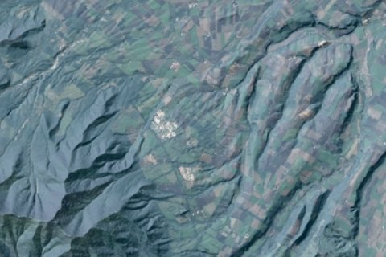 | 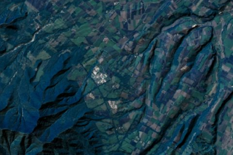 |

通常合成では陰影の灰色が全体にかかり、畑の色がくすみます。乗算では陰影起伏図の白い部分（平坦地や日の当たる斜面）は写真の色がそのまま残り、影になる斜面だけが暗くなります。地形の立体感と土地利用の色を両立させたいなら、乗算が素直な選択です。

| 輝度 | カラー |
|---|---|
| 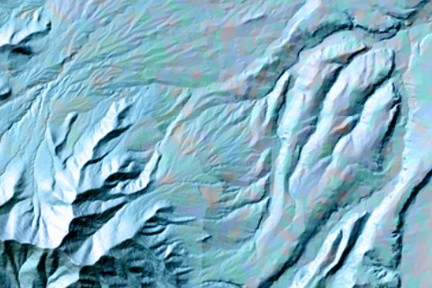 | 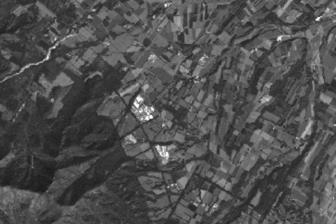 |

`color` は「上のレイヤーの色相・彩度」を使うので、灰色の陰影起伏図を上に置くと写真がモノクロになります。仕様の説明にある「hillshade のようなモノクロのコンテンツに色を付けるのに便利」は、陰影を**下**、色の付いたレイヤー（色別標高図など）を**上**に置く使い方を指していると読めます。順序を逆にすると意味が変わる、という点は後でもう一度触れます。

### デモ2：航空写真 × NDVI

| 通常合成（Opacity 0.6） | カラー（Opacity 1） |
|---|---|
| 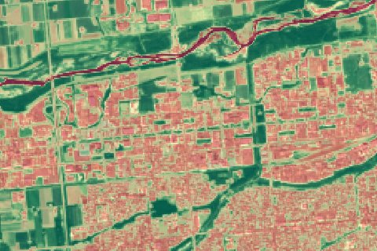 | 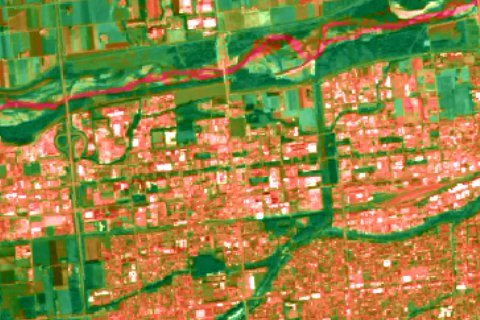 |

`color` では NDVI の色相が写真の明暗に乗るため、圃場の区画や防風林の質感が残ります。見た目としては一番わかりやすい組み合わせでした。

ただし、**ブレンド後の表示色は凡例と一致しません**。`color` では明るさを写真から取るので、NDVI が同じでも、写真が暗い場所は暗い緑、明るい場所は明るい緑になります。`multiply` では写真が暗いところほど色の差がつぶれ、`screen` では赤〜緑が全体に白っぽくなります。

| 乗算 | スクリーン |
|---|---|
| 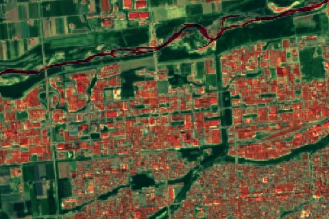 | 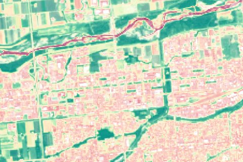 |

数値を読ませる地図では、ブレンドは「位置関係や分布をつかむための表示」と割り切り、値は元のデータから読むようにしたほうが安全です。アプリでは、カーソル位置の NDVI 値と凡例上の色を別に表示しています。

### デモ3：背景地図 × 道路・河川

帯広市街と十勝川です。道路・河川のラインに `line-layer-blend: screen` を指定しました。

| 通常合成（Opacity 0.8） | スクリーン（Opacity 1） |
|---|---|
| 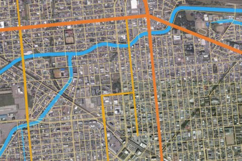 | 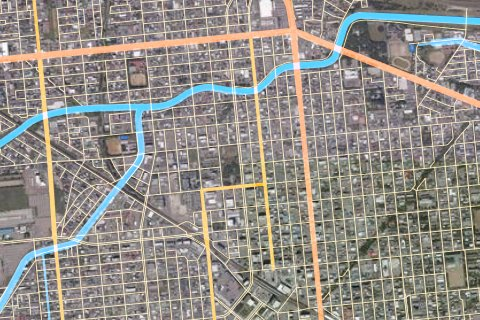 |

スクリーンは結果が必ず下地より明るくなるので、樹林や河川敷などの暗い場所では線が浮きます。一方、明るい市街地の上では線が白っぽくなり、道路種別ごとの色の差は通常合成より読み取りにくくなりました。「スクリーンにすれば視認性が上がる」とは言えず、下地の明るさ次第です。

背景を暗くすると印象が変わります。黒はスクリーンで変化しないので、暗い背景では線の色がほぼそのまま出ます。

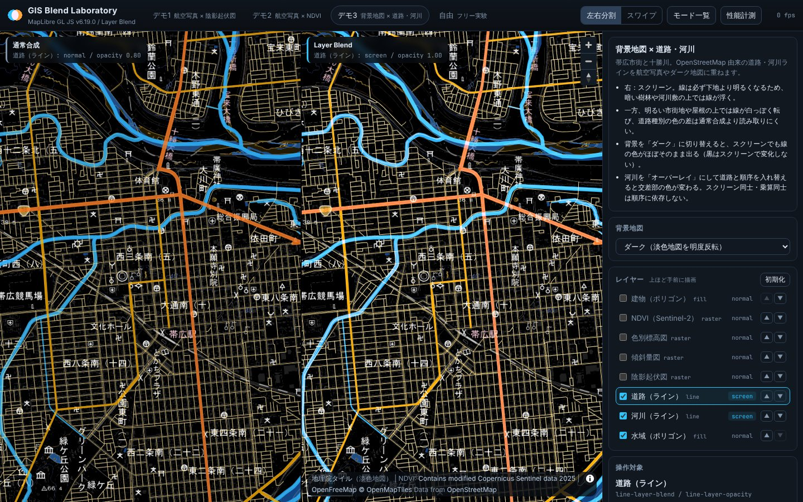

## 6. 比較結果

### 画素値は W3C の式どおりか

アプリに「ピクセル検査」機能を付けました。地図上の 1 点について、(1) 対象レイヤーを消した下地、(2) 対象レイヤー単体、(3) 実際の合成結果、の RGB を WebGL の `readPixels` で読み、(1)(2) から式で計算した理論値と (3) を比べます。

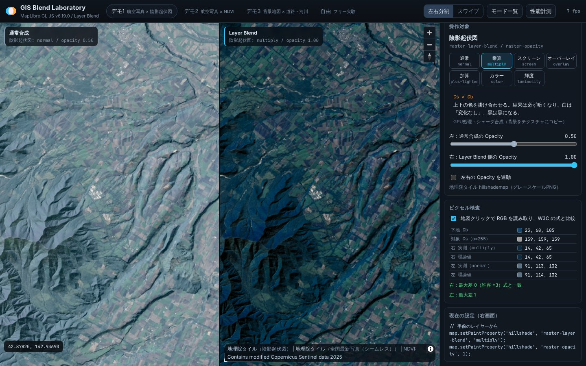

ラスター（陰影起伏図・NDVI）、ポリゴン（水域）、ライン（道路）の 4 種類について、7 モード × 不透明度 1 / 0.5、各 12 点で比較した結果、実測値と理論値の差は RGB の最大で 1（0〜255 の 8bit 値）でした。丸め誤差の範囲で、式どおりに合成されていると言えます。不透明度 0.5 の場合も「上の色に不透明度を掛けてから合成する」というモデルで一致しました。

なお、最初の測定では不透明度 0.5 のときだけ大きくずれました。原因は paint プロパティのトランジション（既定 300ms）で、プロパティを変えた直後に読むと途中の値が描かれていました。画素値を比べる用途では、スタイルの `transition` を `{duration: 0}` にしておく必要があります。

### 描画順序の影響

色別標高図と陰影起伏図を航空写真に重ね、2 枚の順序だけを入れ替えて 24 点の画素差を測りました。

| 色別標高図 | 陰影起伏図 | 最大差 | 平均差 |
|---|---|---:|---:|
| multiply | multiply | 1 | 0.42 |
| screen | screen | 1 | 0.38 |
| multiply | screen | 154 | 145.58 |
| overlay | normal | 67 | 50.92 |
| overlay | multiply | 44 | 5.13 |
| color | luminosity | 55 | 13.46 |

乗算同士・スクリーン同士は掛け算・足し算の入れ替えなので順序に依存しません。それ以外の組み合わせでは順序で結果が変わります。Layer Blend は「そのレイヤーより下に描かれたものすべて」と合成されるため、レイヤーの並び順もスタイル設計の一部になります。

### 描画性能

対象レイヤーを 1 / 4 / 8 枚に複製し、`map.redraw()`（同期描画）と 1 画素の `readPixels`（GPU の完了待ち）の時間をモードごとに 60 フレーム測りました。

**測定条件**：Headless Chromium 157、WebGL は SwiftShader（CPU によるソフトウェア描画）、キャンバス 539×844px、DPR 1。手元に GPU のない環境で測った参考値で、実機の GPU 性能を表すものではありません。

道路（line）の結果（平均 ms、括弧内は normal・不透明度 1 との比）：

| | 1 枚 | 4 枚 | 8 枚 |
|---|---:|---:|---:|
| normal（opacity 1） | 38.8 | 40.6 | 69.7 |
| normal（opacity 0.8） | 43.2（1.11） | 48.1（1.18） | 132.7（1.90） |
| multiply | 43.7（1.13） | 88.4（2.18） | 133.2（1.91） |
| screen | 42.8（1.10） | 82.0（2.02） | 136.8（1.96） |
| color | 45.3（1.17） | 86.9（2.14） | 157.2（2.25） |

陰影起伏図（raster）の結果：

| | 1 枚 | 4 枚 | 8 枚 |
|---|---:|---:|---:|
| normal | 26.8 | 51.1 | 86.3 |
| multiply | 33.2（1.24） | 71.8（1.41） | 129.4（1.50） |
| screen | 28.5（1.06） | 74.1（1.45） | 106.4（1.23） |
| color | 33.0（1.23） | 70.9（1.39） | 135.8（1.57） |

（全モードの結果はリポジトリの `docs/results/README.md`）

この環境で言えるのは次の程度です。

- ブレンドを使うレイヤーが増えるほど、normal との差が開く（8 枚で 1.2〜2.3 倍）
- line では、normal でも `line-layer-opacity` を 0.8 にしただけで 8 枚時に 1.9 倍になり、ブレンド各モードとほぼ同じ。コストの大半は「オフスクリーンに描いて合成する」パスの追加にあると考えられる
- 固定機能ブレンド（screen、plus-lighter）とシェーダ合成（multiply など）の差は、計測のばらつきと区別できなかった

実際の画面の FPS は垂直同期で頭打ちになるので、この差がそのまま体感に出るわけではありません。実機 GPU や Firefox・Safari での計測はまだできていないため、アプリの「性能計測」ボタンから各自の環境で測れるようにしてあります。

## 7. 制約・注意点

ソースコードと仕様から確認できた制約をまとめます。

- **対象は raster / fill / line のみ**。`hillshade` レイヤーや `fill-extrusion` には使えない
- **値は定数のみ**。ズームに応じてモードを変える、フィーチャーごとに変える、といったことはできない。トランジションもない
- **合成の相手は「下に描かれたものすべて」**。背景色も含む。複数のレイヤーをまとめて 1 つのグループとしてブレンドする機能はない
- **背景のコピー範囲**：`multiply` / `overlay` / `color` / `luminosity` は描画のたびに下地をテクスチャにコピーする。ラスターは画面全体、fill/line はタイル範囲の外接矩形。地形（terrain）や地球儀表示（subdivision あり）では画面全体になる
- **不透明パスの最適化が効かなくなる**：シェーダ合成のレイヤーがあると、それより下のレイヤーは「手前から描いて隠れる部分を省く」最適化の対象から外れる（`painter.ts` の `opaquePassCutoff`）
- **WebGL2 が前提**（合成シェーダが `texelFetch` を使う。v6 自体も WebGL2 必須）
- **特定 GPU の不具合回避**：Mesa 24.3〜25.3.1 の Intel Gen12 で、連続する合成レイヤーの描画が乱れる問題に対して 6.18.0 で回避策が入っている
- **Native 未対応**：MapLibre Native（Android/iOS）では使えないので、Web と共通のスタイルを使う場合は注意
- **凡例との不一致**：ブレンド後の色はデータの値と 1 対 1 に対応しない
- **ブラウザ**：今回動作を確認したのは Chromium（Headless、SwiftShader）のみ。Firefox、Safari、実機 GPU での表示・性能は未検証

## 8. まとめ

- MapLibre GL JS v6.18 で、raster / fill / line レイヤーに 7 種類のブレンドモードを指定できるようになった
- 合成結果は W3C の式どおりで、実測でも RGB の差は最大 1 だった
- GIS では「陰影起伏図 × 乗算」「暗い背景 × スクリーン」「陰影の上に段彩 × カラー」が使いやすい
- 一方、明るい下地の上のスクリーンは線が白っぽくなる、数値ラスターは凡例と色が一致しなくなる、レイヤーの並び順で結果が変わる、といった点は設計時に意識が必要
- 性能面では、モードの違いよりも「オフスクリーン合成のレイヤーが何枚あるか」が効いていそう（ソフトウェア描画での参考値）

これまで GIS ソフトで作った陰影付きの地図を Web に載せるときは、画像を事前に合成しておくか、Opacity で妥協することが多かったと思います。スタイルの指定だけで表現できるようになったので、地図づくりの選択肢がひとつ増えました。

## 参考

- MapLibre GL JS CHANGELOG（6.18.0）：https://github.com/maplibre/maplibre-gl-js/blob/main/CHANGELOG.md
- MapLibre Style Specification：https://maplibre.org/maplibre-style-spec/layers/
- Interactive layer blending（公式サンプル）：https://maplibre.org/maplibre-gl-js/docs/examples/interactive-layer-blending/
- W3C Compositing and Blending Level 1：https://www.w3.org/TR/compositing-1/
- 地理院タイル一覧：https://maps.gsi.go.jp/development/ichiran.html
- OpenFreeMap：https://openfreemap.org/
- Copernicus Sentinel-2（Earth Search）：https://earth-search.aws.element84.com/v1

出典：地理院タイル（全国最新写真（シームレス）、淡色地図、陰影起伏図、傾斜量図、色別標高図）／© OpenStreetMap contributors、OpenMapTiles、OpenFreeMap／Contains modified Copernicus Sentinel data 2025
